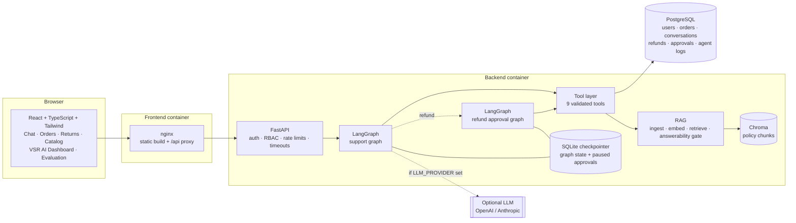
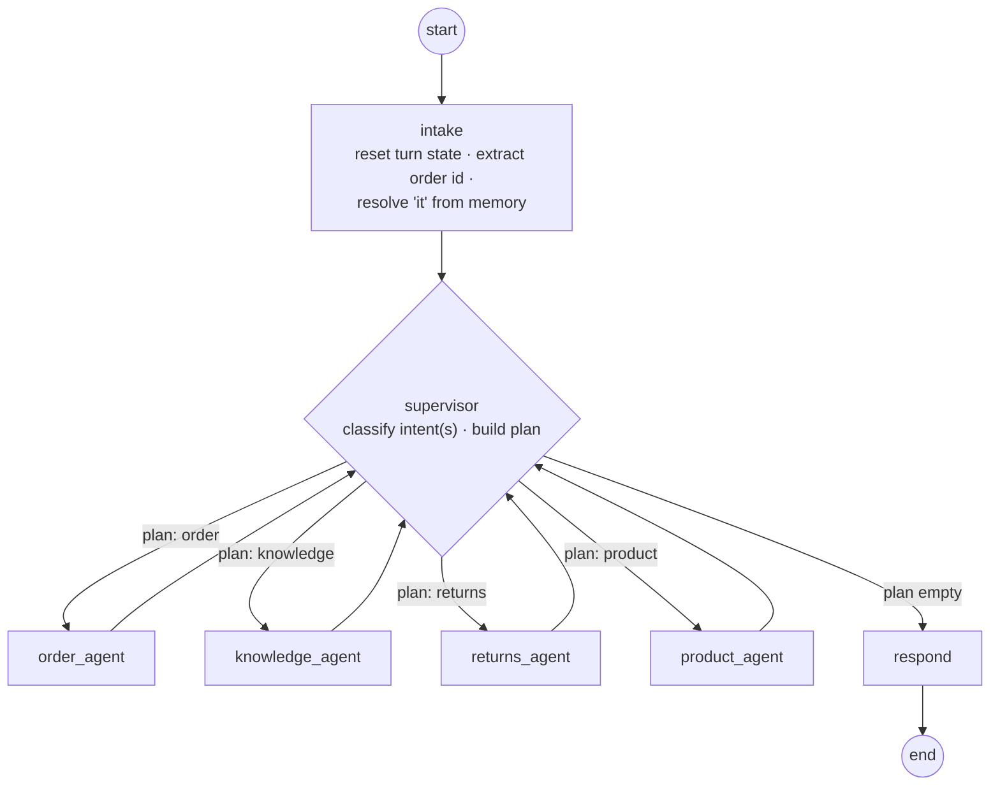
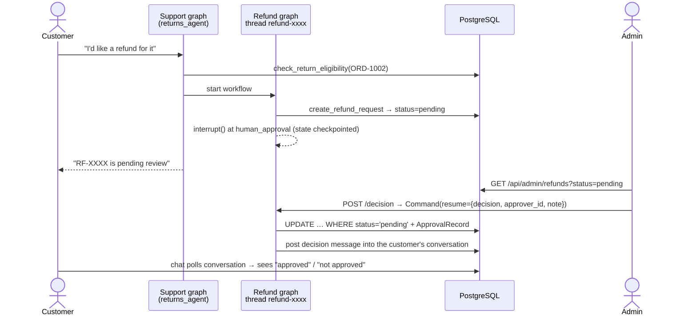
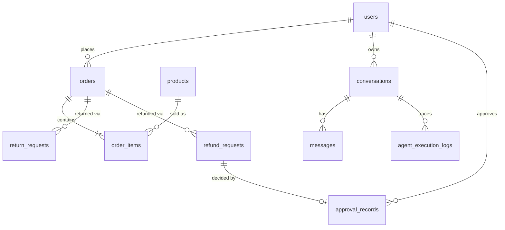

# VSR AI — Architecture

## System overview

## Support graph (one thread per conversation)

The supervisor turns intents into an ordered plan, for example `return_eligibility → [returns_agent, knowledge_agent]`. After each specialist runs, control returns to the supervisor, which routes to the next agent in the plan via a conditional edge. This is how multi-agent coordination happens: for "Can I return it?", the Returns agent checks the order's eligibility against the database and the Knowledge agent retrieves the governing Return Policy with citations. The respond node then combines both.

State lives in a `TypedDict` (`SupportState`). `messages` uses LangGraph's `add_messages` reducer and, together with `active_order_id`, is persisted by the checkpointer under `thread_id = conversation id`. That checkpoint is the conversation memory. The remaining fields (`intents`, `plan`, `agent_path`, `trace`, `citations`) are per-turn working state, reset by `intake`.

## Refund approval graph (human-in-the-loop)

The approval workflow runs as its own checkpointed thread (`refund-<uuid>`), started from inside the Returns agent in a fresh `contextvars` context. The customer's conversation therefore stays usable while the refund waits, and a paused approval survives server restarts.

Duplicate refunds are prevented at three layers. The eligibility check refuses when an active refund exists. A database unique constraint on `(order_id, active_key)` blocks concurrent duplicates. The decision is applied with a conditional `UPDATE … WHERE status = 'pending'`, so a second approval is a no-op that returns HTTP 409.

## Agents and tools

| Agent | Tools it calls | Notes |
|---|---|---|
| Supervisor | none | Rules (default) or LLM structured output (`RouteDecision`) |
| Orders | `get_order_status`, `get_order_details`, `get_customer_orders` | LLM tool-calling loop when an LLM is configured |
| Knowledge | `search_knowledge_base` | Extractive answers with citations; answerability gate; LLM synthesis when configured |
| Returns & Refunds | `check_return_eligibility`, `create_return_request`, `create_refund_request`, `get_refund_status` | Always deterministic. Refunds only via the approval graph |
| Products | `search_products` | LLM tool-calling loop when configured |

All tools receive a `ToolContext` bound to the authenticated user. The customer id is never read from model output, and lookups of other customers' orders return the same "not found on your account" message as missing orders, so order existence is not leaked. `create_refund_request` is deliberately not exposed to the LLM tool list.

Every tool call is timed and written to `agent_execution_logs` with redacted inputs. Each agent node also logs its own execution. The admin dashboard computes all metrics from these logs and the business tables.

## RAG pipeline

1. **Load** the six Markdown policies in `backend/app/rag/policies/`.
2. **Clean:** normalise whitespace and drop lines matching prompt-injection patterns (defence in depth).
3. **Chunk** by `##` section, with 120-word windows and 25-word overlap. This produces 33 chunks, each carrying document and section metadata.
4. **Embed** with `HashingEmbedder`, a deterministic and offline embedding: feature hashing of stemmed unigrams and bigrams into 1024 dimensions. Alternatively, OpenAI embeddings can be used via `EMBEDDING_PROVIDER=openai`.
5. **Store** in Chroma, using cosine distance.
6. **Retrieve** the top 5 chunks. Intent-specific lookups (return, refund, cancellation) are scoped to the governing policy document.
7. **Gate answerability:** compute the IDF-weighted coverage of the (synonym-expanded) question by the best chunk. Question terms absent from the whole corpus carry double weight. Below 0.20, the agent says the information is unavailable.
8. **Answer:**
   - Deterministic mode extracts the best-supported sentences with `[n]` citations.
   - LLM mode answers only from `<policy_document>` blocks, which the prompt marks as untrusted data.

## Security and reliability

- **Auth:** JWT bearer tokens with PBKDF2-SHA256 password hashing; customer and admin roles enforced server-side (`require_admin`).
- **Access rules:** customers can't approve refunds (403); admins can't decide their own refunds; conversations are owner-scoped (404 for anyone else).
- **Validation:** Pydantic schemas (message ≤ 2000 chars, decision enum, note ≤ 500); order-id normalisation and regex validation inside tools.
- **Rate limits:** separate in-memory sliding-window buckets for login (10/min), chat (30/min) and general API traffic (300/min). `X-Forwarded-For` is only trusted when `TRUST_PROXY_HEADERS=true`, and the bundled nginx overwrites rather than appends that header.
- **Timeouts:** per-request (45 s), LLM client (30 s), and frontend fetch abort (45 s).
- **Error handling:** consistent JSON error bodies; unhandled errors are logged and never leak internals; graph failures are logged as failed executions and return a safe message.
- **Logging:** a redaction filter masks emails, card-like numbers, phone numbers, API keys and bearer tokens.
- **Secrets:** read only from environment variables. `.env` is git-ignored and nothing secret reaches the frontend bundle.
- **Payments:** none. All refunds are simulated (`SIM-TXN-…` ids), and all data is synthetic.

## Data model

