<p align="center"></p>

<h1 align="center">VSR AI — Enterprise Agentic Customer Support Platform</h1>

<p align="center">A multi-agent customer support platform built with LangGraph, FastAPI, PostgreSQL, Chroma and React.<br/>
Every reply shows which agents handled it, which tools they called, and which policy it came from. Refunds wait for a human.</p>

<p align="center"><a href="https://github.com/vayusudhag/vsr-agentic-ai-platform/actions/workflows/ci.yml"></a></p>

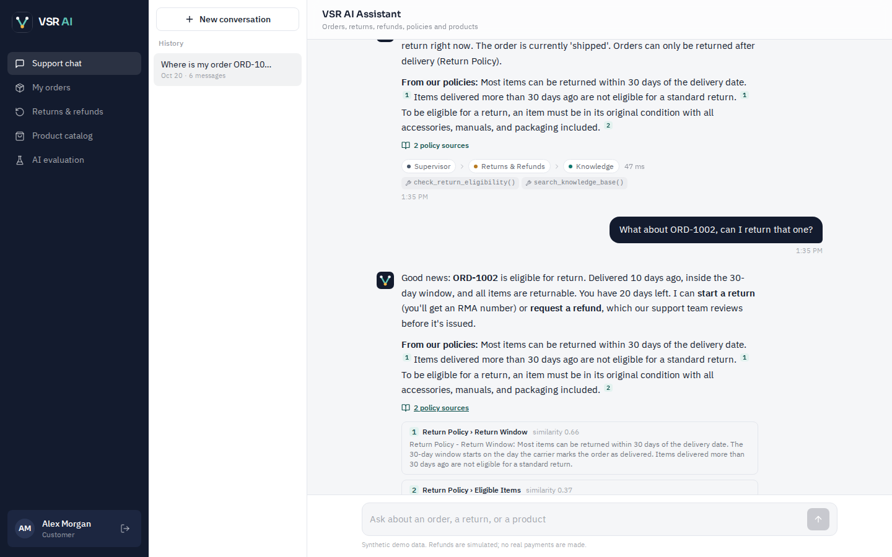

<p align="center"><a href="https://vsr-ai-frontend.onrender.com"><b>▶ Live demo: vsr-ai-frontend.onrender.com</b></a><br/>
<sub>One-click sign-in as a customer or the admin. Hosted on Render's free tier, so the first visit after a quiet period can take up to a minute while the backend wakes up.</sub></p>

> **Status:** deployed on Render and tested. All data is synthetic and all refunds are simulated. Published results come from the **deterministic agent mode**. The LLM mode is implemented but **not evaluated** (see [Deterministic vs LLM](#deterministic-vs-llm-powered-modes)).

## 1. Overview

VSR AI Assistant handles the requests that fill a retail support queue:
- where is my order;
- can I return it;
- refund it;
- what does the warranty cover;
- what should I buy.

A LangGraph supervisor routes each request to specialist agents. They call validated tools against a PostgreSQL order database and a Chroma index of company policies. Refunds pause in a checkpointed workflow until an admin approves them in the VSR AI Dashboard. An evaluation suite measures routing, tool choice, task completion, retrieval and grounding, and the app displays the results.

## 2. Business problem

Support teams spend much of their time on repetitive lookups: order status, return eligibility, policy questions. A chatbot that only generates text can't safely help, because it may:
- invent policies;
- leak one customer's data to another;
- trigger money movement without oversight.

## 3. Solution

- **Specialist agents with real tools.** Answers about orders come from the database, not the model.
- **Grounded policy answers.** Every policy statement carries a citation. When the documents don't cover a question, the assistant says so.
- **Human-in-the-loop for money.** Refunds are created as *pending* and pause in a LangGraph `interrupt()` until an authorized admin decides. The workflow then resumes and notifies the customer.
- **Isolation by design.** Tools are bound to the authenticated user, so the model can't choose whose data to read.
- **Measured, not claimed.** A reproducible evaluation with held-out sets, run history and documented failures.

## 4. Architecture

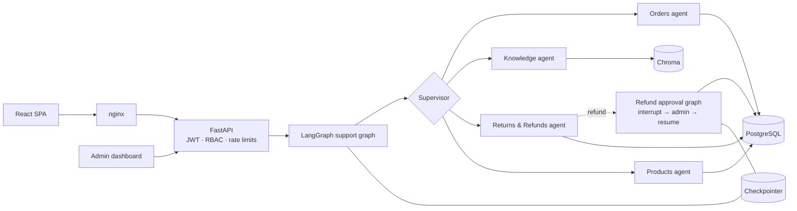

Node-level graphs, the approval sequence diagram, the data model and security details are in **[ARCHITECTURE.md](ARCHITECTURE.md)**.

## 5. Technology stack

| Layer | Technology |
|---|---|
| Frontend | React 18, TypeScript, Tailwind CSS, React Router, Recharts, lucide-react, self-hosted Sora + IBM Plex Sans |
| Backend | Python 3.12, FastAPI, Pydantic v2, SQLAlchemy 2, PyJWT |
| Agents | LangGraph 1.2 (StateGraph, conditional edges, `interrupt`/`Command`, SQLite checkpointer), LangChain Core tools |
| LLM (optional) | `langchain-openai` / `langchain-anthropic` |
| RAG | Chroma 1.5, offline hashing embeddings (OpenAI embeddings optional) |
| Data | PostgreSQL 16 (SQLite for zero-setup development) |
| DevOps | Docker, Docker Compose, nginx, GitHub Actions, pytest, Playwright |

## 6. Features

- **Five agents in one graph:** supervisor, orders, knowledge (RAG), returns & refunds, products. Requests needing several agents run them in sequence, for example "Can I return it?" goes Returns → Knowledge.
- **Nine tools:**
  - orders: `get_order_status`, `get_order_details`, `get_customer_orders`;
  - catalog and policies: `search_products`, `search_knowledge_base`;
  - returns and refunds: `check_return_eligibility`, `create_return_request`, `create_refund_request`, `get_refund_status`.
  - All are validated, ownership-checked and logged.
- **Conversation memory:** order ids carry across turns ("it" → ORD-1001). Conversations persist, can be reopened, and are isolated per customer.
- **Human approval:**
  - pending queue in the dashboard;
  - approve or reject with a note;
  - approver and timestamp recorded;
  - duplicate decisions blocked (409);
  - customers can't approve (403), and admins can't decide their own requests;
  - the decision is posted back into the customer's conversation.
- **RAG with abstention:**
  - 6 policy documents, 33 chunks;
  - numbered citations with excerpts and similarity scores;
  - an IDF-coverage answerability gate;
  - injection-pattern lines stripped at ingestion.
- **VSR AI Dashboard:** conversations, requests, pending approvals, completed requests, failed tool calls, average and p95 latency, agent usage, intent mix, tool table, recent decisions. All computed live.
- **AI evaluation dashboard:** latest results, a deterministic-vs-LLM panel, run history, and known failures.
- **Security:** JWT, role checks, input validation, per-bucket rate limits, request timeouts, redacted logs, secrets only from environment variables.

## 7. Installation

```bash
cp .env.example .env            # set POSTGRES_PASSWORD and JWT_SECRET
docker compose up --build       # http://localhost:8080
```

Both Docker images are built in CI on every push, and the hosted backend runs from `backend/Dockerfile`. To run without Docker:

```bash
cd backend && pip install -r requirements-dev.txt && python -m app.seed && python -m app.rag.ingest && uvicorn app.main:app --port 8000
cd frontend && npm ci && npm run dev    # http://localhost:5173
```

Demo accounts: `pardha.saradhi@example.com` and `pavan.y@example.com` / `demo1234` (customers) and `gopireddy.vsr@example.com` / `admin1234` (admin), also available as one-click sign-in buttons.

## 8. Screenshots

All screenshots were captured by `scripts/browser_e2e.py` (headless Chromium) from the running application, served through the production nginx config.

| | |
|---|---|
| 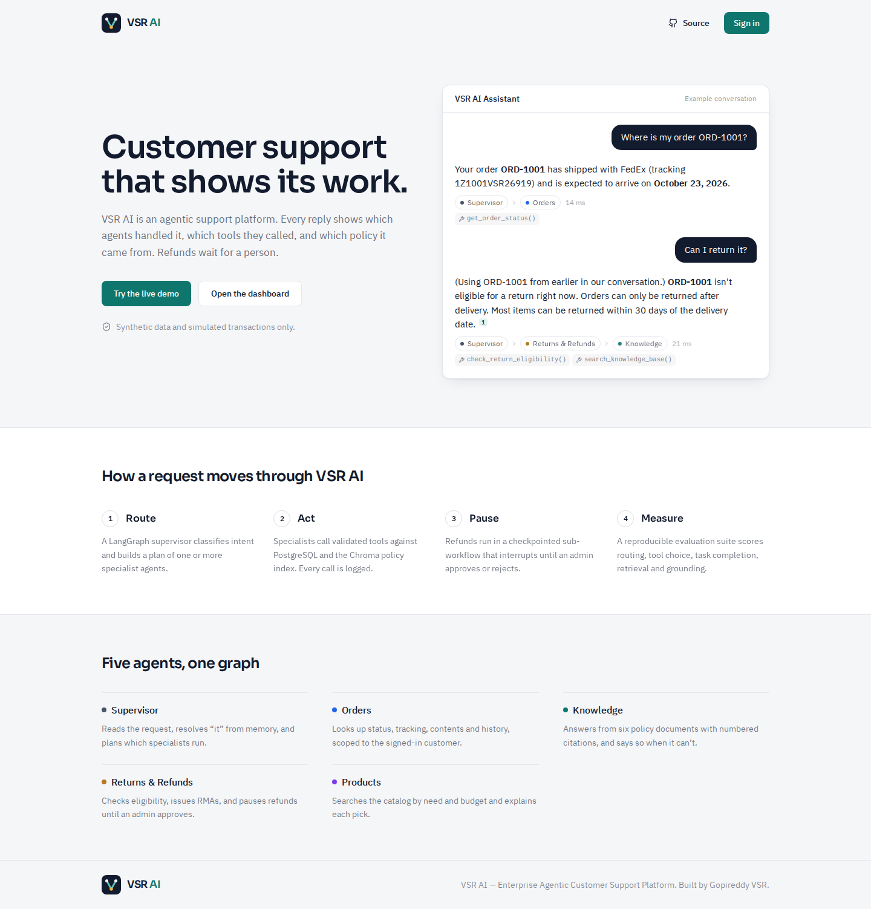 Landing page | 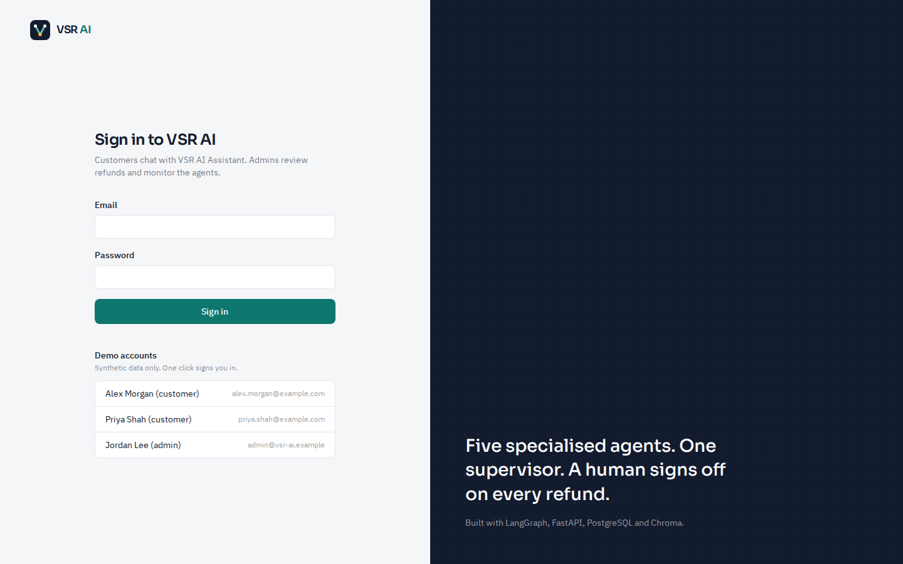 Sign in with demo accounts |
| 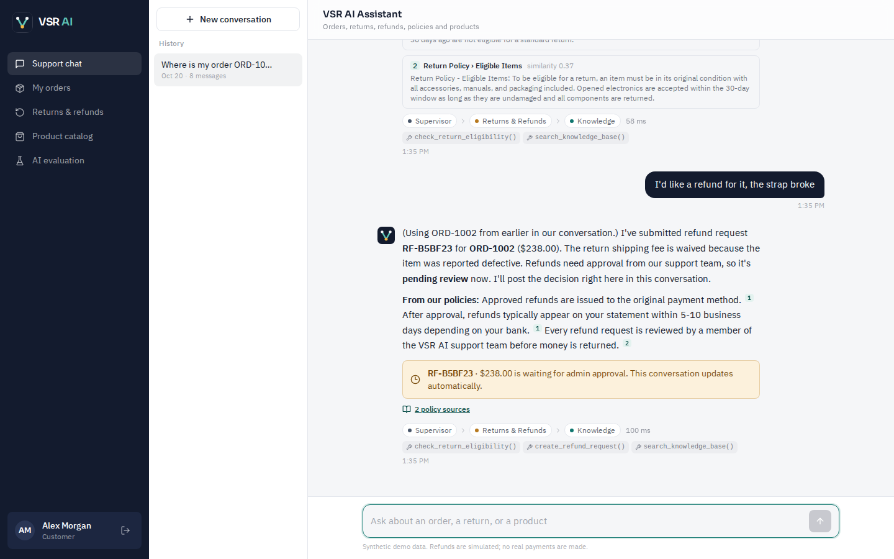 Refund paused for human approval | 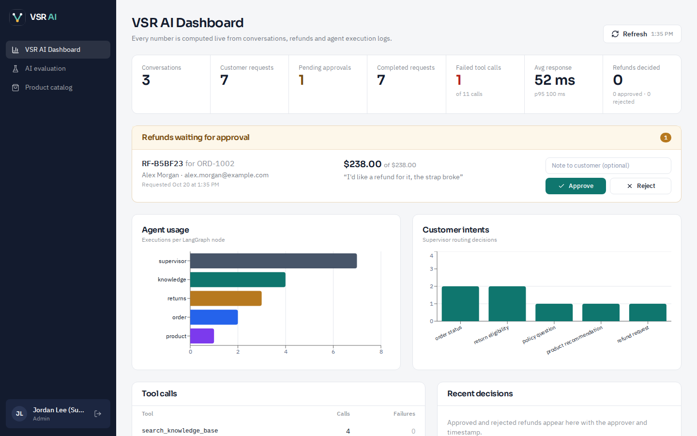 VSR AI Dashboard approval queue |
| 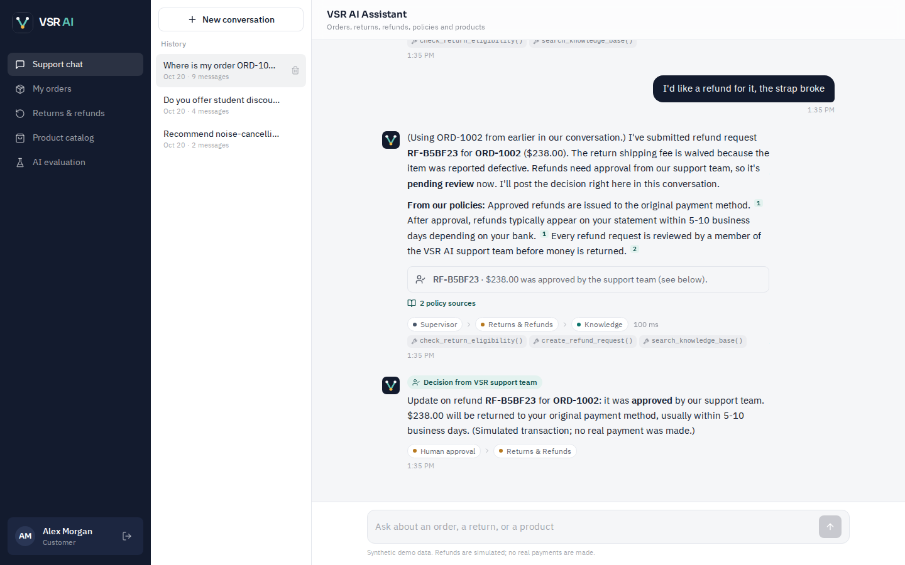 Resumed workflow posts the decision | 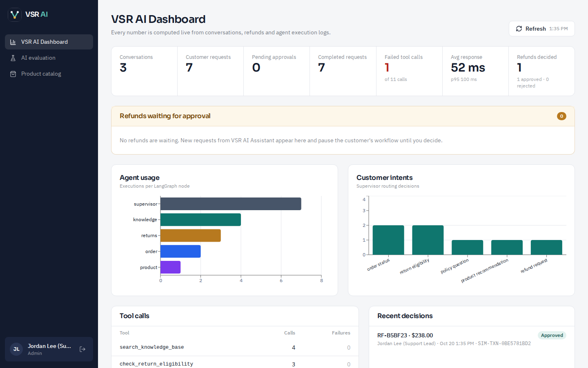 Dashboard after approval |
| 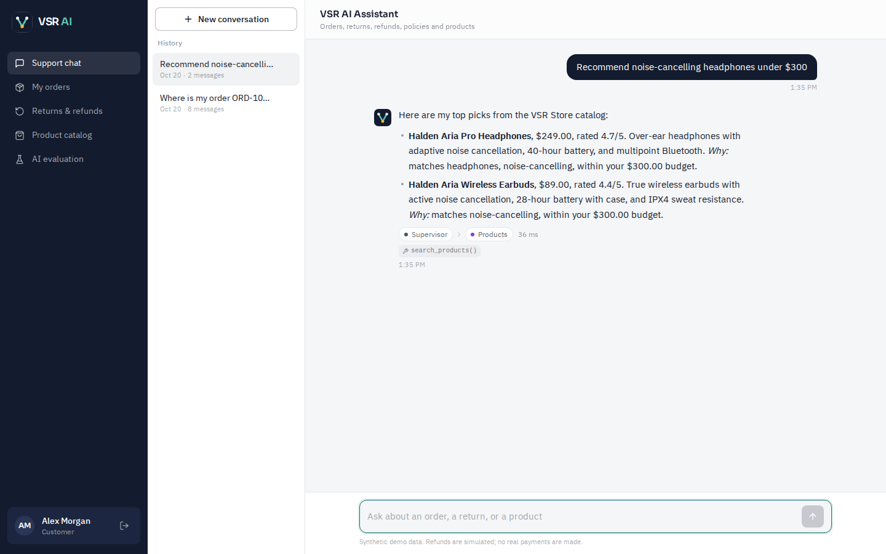 Product recommendations | 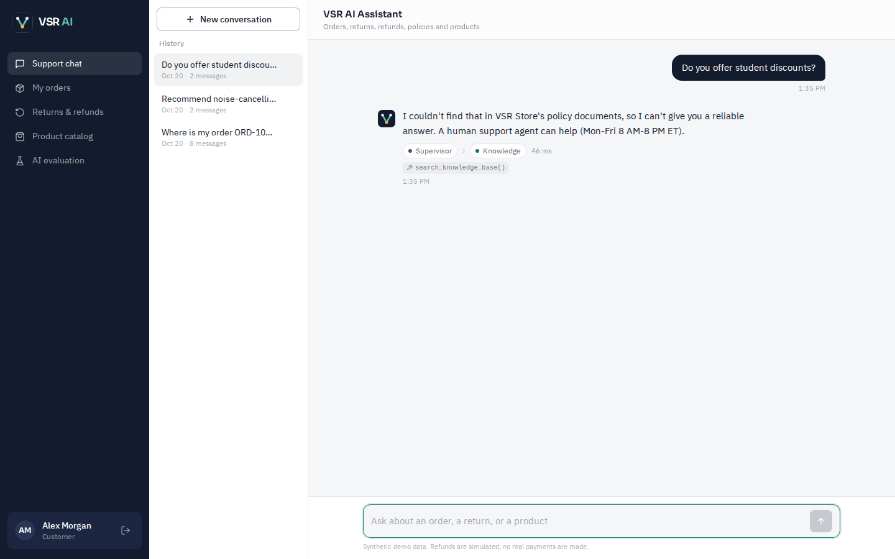 Declines unsupported questions |
| 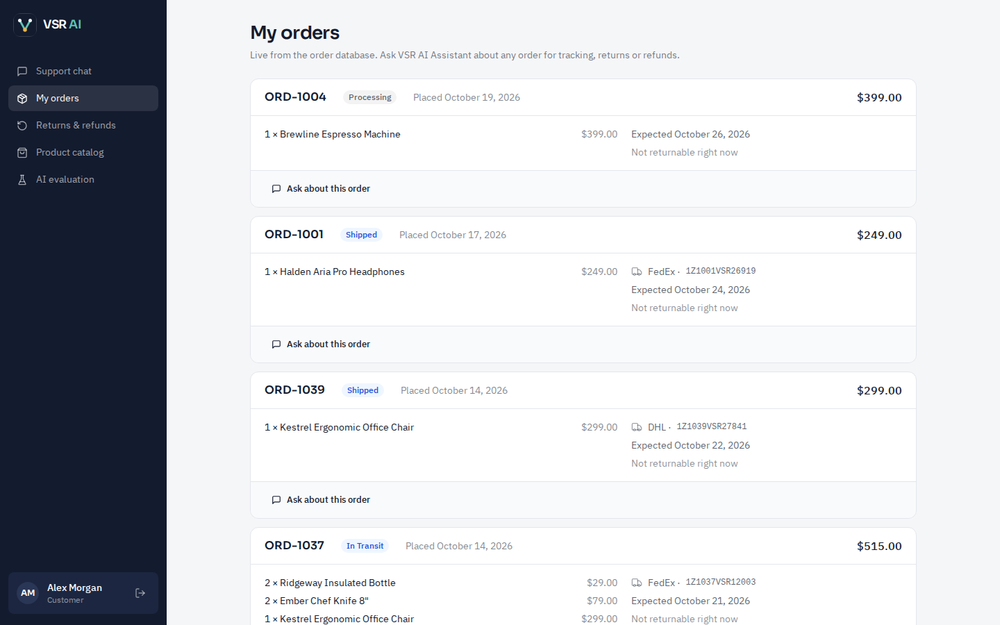 My orders | 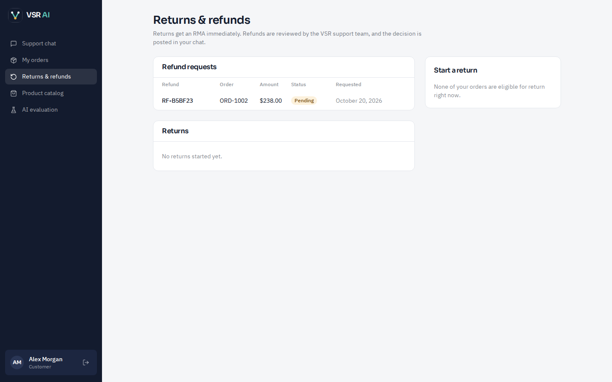 Returns & refunds |
| 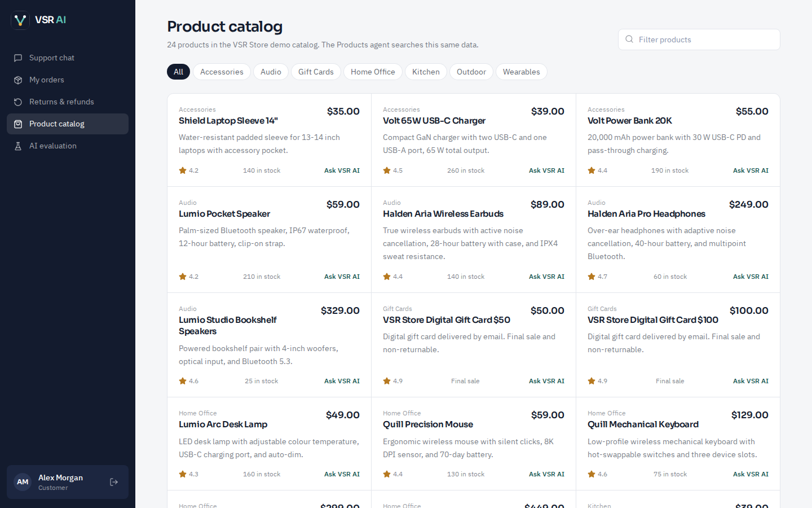 Product catalog | 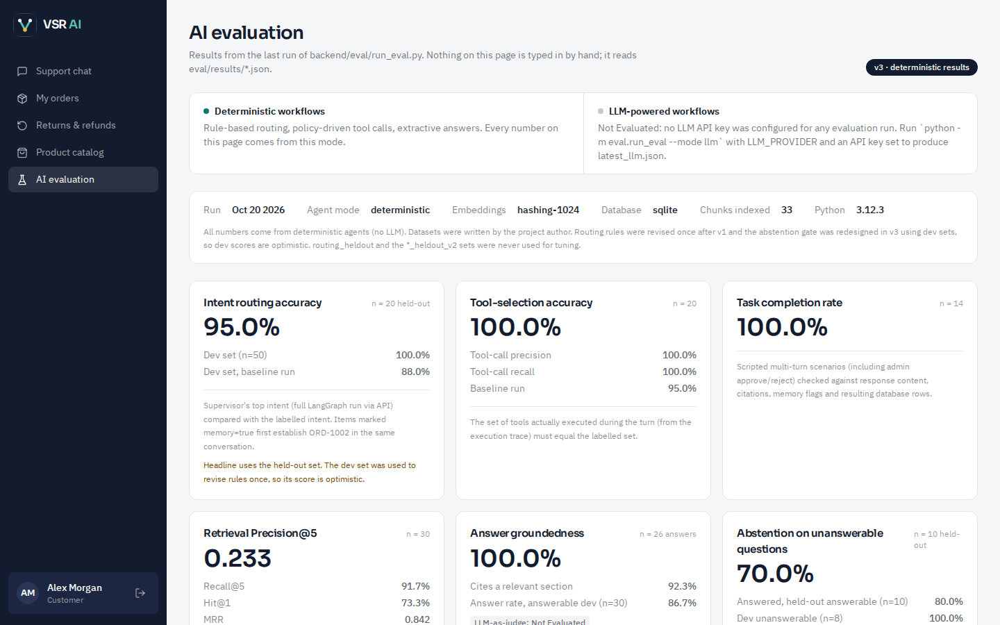 AI evaluation dashboard |
| 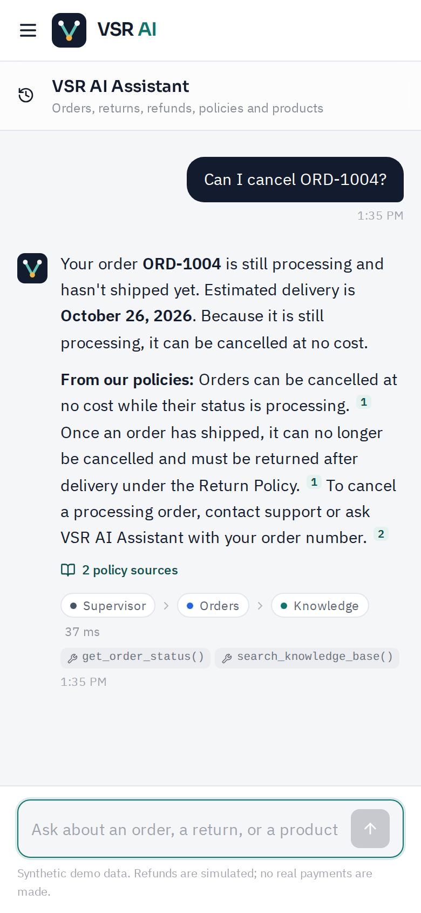 Mobile chat | 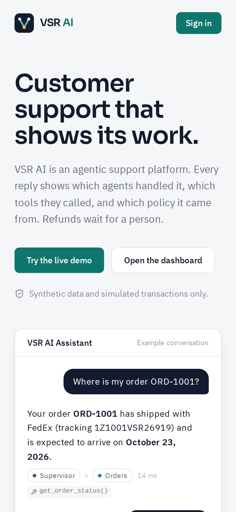 Mobile landing |

## 9. Demo scenarios

Step-by-step instructions with order ids and expected output are in **[DEMO.md](DEMO.md)**:

1. Order status
2. Return-policy question with citations
3. Refund with human approval
4. Product recommendations
5. Follow-up using conversation memory
6. Extras: cross-customer protection, multi-agent cancellation, ineligible returns

## 10. Evaluation methodology

`backend/eval/run_eval.py` reseeds an isolated database, then drives the real API. It covers:
- 50 + 20 routing items;
- 20 tool-selection items;
- 14 multi-turn task scenarios, including admin approve/reject;
- 30 labelled retrieval queries;
- 18 + 10 answerable/unanswerable checks;
- latency on every chat request.

Dev sets were used for tuning; **held-out sets were not**, and those are the headline numbers. Full definitions are in **[EVALUATION.md](EVALUATION.md)**.

## 11. Benchmark results (deterministic mode, v3)

| Metric | Result | n |
|---|---|---|
| Intent routing accuracy (held-out) | **95.0%** | 20 |
| Tool-selection accuracy | **100%** | 20 |
| Task completion rate | **100%** | 14 |
| Retrieval Precision@5 | **0.233** (best possible on this set: 0.26) | 30 |
| Recall@5 · MRR | 91.7% · 0.842 | 30 |
| Answers citing a relevant section | 92.3% | 26 |
| Abstention on unseen out-of-scope questions | **70%** | 10 |
| Answered unseen answerable questions | **80%** | 10 |
| Lexical groundedness | 100% (extractive by construction) | 26 |
| LLM-as-judge groundedness | **Not Evaluated** | – |
| API latency, in-process | p50 **28 ms**, p95 42 ms | 185 |

Run history (v1 → v3), the abstention trade-off, and every known failure are documented in EVALUATION.md. Per-item CSVs are in `backend/eval/results/`.

### Deterministic vs LLM-powered modes

| Mode | Status |
|---|---|
| Deterministic (`LLM_PROVIDER=none`): rule routing, policy-driven tool calls, extractive answers | Tested (62 tests, browser E2E) and **evaluated**, as above |
| LLM-powered (`openai` / `anthropic`): LLM routing, tool-calling loops, grounded synthesis | **Implemented, never executed, not evaluated.** No API key was available |

Refund and return actions remain deterministic in both modes.

## 12. Tests

- **62 pytest tests** covering:
  - tools, ownership and validation;
  - eligibility scenarios;
  - refunds and duplicates;
  - routing and graph structure;
  - RAG retrieval, abstention and injection stripping;
  - memory and isolation;
  - approval workflow and RBAC;
  - API errors, rate limits and redaction.
  - All pass on SQLite and PostgreSQL 16.
- **Frontend:** `tsc` typecheck and production build both pass.
- **Browser E2E:** `scripts/browser_e2e.py` passes with no console errors or unexpected API errors.
- **CI:** `.github/workflows/ci.yml` runs the tests on both databases, the evaluation, the frontend build, and a Docker image build. It runs on every push to `main`; see the repository's Actions tab for the latest result.

## 13. Deployment

Live at **https://vsr-ai-frontend.onrender.com**.

- **Frontend:** a Render Static Site built with `VITE_API_BASE_URL` pointing at the backend, plus a rewrite rule (`/*` → `/index.html`) so client-side routes such as `/login` survive a page refresh.
- **Backend:** the FastAPI service, deployed on Render's free tier from `backend/Dockerfile`. Free instances sleep when idle, so the sign-in page lists the demo accounts immediately, polls `/api/health` while the backend wakes, and enables sign-in once it responds, with a retry option if startup takes longer than two minutes.
- **Startup:** `app.bootstrap` creates tables, seeds the demo data and builds the Chroma index only when they are missing, so a restarted instance comes back ready to use.

Other deployment options (single VM with Compose, or managed PostgreSQL) and the constraints to respect are in [SETUP.md](SETUP.md#deployment-approach).

## 14. Known limitations

- **LLM mode is unverified.** Its code paths have no test or evaluation coverage.
- **Rule-based routing has brittle edges.** For example, "Was my refund processed?" is misrouted, and "something" or "buy" can pull policy questions toward the product agent.
- **Abstention is imperfect.** 3 of 10 unseen out-of-scope questions got loosely related policy text. The stricter gate also refuses some answerable questions (dev answer rate 86.7%).
- **The embeddings are lexical** (feature hashing). Retrieval relies on shared vocabulary plus a small synonym map. Semantic embeddings should improve recall on paraphrases.
- **The evaluation is small and self-authored** (n = 10–50 per set). Treat the results as indicative.
- **The backend is single-process only.** Rate limits are in memory, and the LangGraph checkpointer is a local SQLite file. Horizontal scaling needs Redis-backed rate limiting and a Postgres checkpointer.
- **No real integrations.** No email or label delivery, no payment processing, and no cancellation action tool (cancellation is explained, not executed).

## 15. Future improvements

- Run and publish the LLM-mode evaluation, including an LLM-as-judge groundedness metric, alongside the deterministic baseline.
- Hybrid retrieval (BM25 + dense embeddings) with a reranker; a larger, externally labelled evaluation set.
- Learned or LLM router with confidence-based fallback to clarification.
- `langgraph-checkpoint-postgres` and Redis rate limiting for multi-instance deployment.
- Streaming responses (SSE) and live approval notifications (WebSocket) instead of polling.
- A cancellation tool with its own approval rules; observability via OpenTelemetry/LangSmith.

## Repository layout

```
backend/   FastAPI app, agents (LangGraph), tools, RAG + policies, seed, tests, eval (datasets + results)
frontend/  React + TypeScript + Tailwind SPA, nginx.conf, Dockerfile
scripts/   browser_e2e.py (Playwright walkthrough + screenshots)
docs/      screenshots/
.github/   CI workflow
```

## Author

Built by **Gopireddy VSR** — [github.com/vayusudhag](https://github.com/vayusudhag) · [linkedin.com/in/gopireddy-vsr](https://linkedin.com/in/gopireddy-vsr). MIT licensed.
